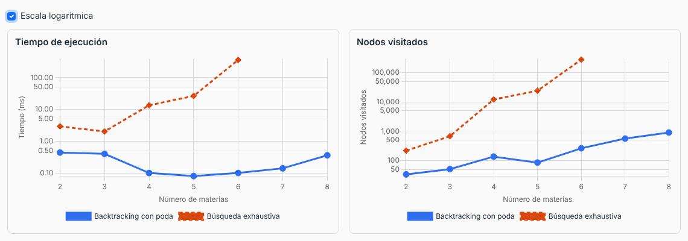

# Resultados preliminares — Checkpoint 2

Comparación de la **búsqueda exhaustiva** (algoritmo base, BR-01) contra el **backtracking con poda** (segunda técnica, BR-02), y medición de las **mejoras de poda** (BR-05). Es la comparación preliminar que pide el Checkpoint 2; las mediciones finales con las tres estrategias (exhaustiva, backtracking y voraz) son de BR-06.

Medido el 24/11/2026 con la oferta real del respaldo y Node.js 22.

## Qué cambió de una técnica a la otra

Las dos búsquedas reciben el mismo `Problema` y devuelven el mismo top 3 (las reglas están en `reglas-horario.md`).

- **Búsqueda exhaustiva:** prueba todas las combinaciones posibles, una sección por materia, y se queda con las 3 mejores. Si las materias tienen k₁, k₂, …, kₙ secciones, evalúa k₁ · k₂ · … · kₙ horarios completos: el trabajo crece de forma exponencial con el número de materias.
- **Backtracking con poda:** arma el horario materia por materia y, en cada paso, calcula una **cota optimista**: lo mejor que podría llegar a ser ese horario a medio armar. Si ni siquiera en el mejor caso puede entrar al top 3, abandona toda la rama sin revisar sus combinaciones (sección 8 de `reglas-horario.md`).

El peor caso del backtracking sigue siendo el mismo producto de secciones, porque si la cota nunca permite podar recorre todo el árbol. En la práctica la cota poda casi todo el árbol, como muestran las mediciones.

## Metodología

| Aspecto | Valor |
| --- | --- |
| Oferta | Respaldo del ciclo 202620 (`datos/oferta-202620.json`): 56 materias, 676 secciones |
| Problemas | Aleatorios con `generarProblemaAleatorio` (BR-03), turno matutino, todas las secciones en el orden en que llegan |
| Tamaños | De 2 a 8 materias, 20 problemas por tamaño (semillas 1 a 20) |
| Exhaustiva | Se mide hasta 6 materias; con 7 o más tarda varios segundos por problema |
| Backtracking | Con las dos mejoras de BR-05 (las predeterminadas); mejor de 5 pasadas por problema |
| Validación | En cada problema medido con las dos búsquedas se comprobó que el top 3 es idéntico |

Métricas (definidas en la sección 9 de `reglas-horario.md`):

- **Nodos visitados:** cuántas veces se coloca una sección en el horario a medio armar. No depende de la computadora, así que es la métrica principal.
- **Tiempo (ms):** depende de la computadora; sirve para ver el orden de magnitud.
- **Horarios posibles:** producto de las secciones de cada materia; es lo que tendría que revisar la exhaustiva.

## Resultados

### Exhaustiva contra backtracking

Promedio de los 20 problemas de cada tamaño.

| Materias | Horarios posibles (prom.) | Nodos exhaustiva | Nodos backtracking | Nodos ahorrados | ms exhaustiva | ms backtracking |
| --- | --- | --- | --- | --- | --- | --- |
| 2 | 244 | 255 | 44 | 82.8% | 1.9 | 0.04 |
| 3 | 3,692 | 3,947 | 84 | 97.9% | 5.8 | 0.03 |
| 4 | 37,640 | 41,586 | 126 | 99.7% | 53.1 | 0.03 |
| 5 | 284,575 | 326,161 | 226 | 99.9% | 506.7 | 0.04 |
| 6 | 3,735,451 | 4,061,613 | 344 | 99.99% | 11,850.8 | 0.07 |
| 7 | 39,601,679 | no se midió | 620 | — | — | 0.12 |
| 8 | 497,170,633 | no se midió | 1,052 | — | — | 0.21 |

En los 100 problemas medidos con las dos búsquedas, el top 3 fue idéntico.

### Gráfica de la página de análisis

Captura de `analisis.html` (AN-07) con la misma oferta, de 2 a 8 materias, 5 repeticiones y escala logarítmica:



La página omite en la exhaustiva los problemas de más de 6 materias o de más de 1,000,000 de horarios posibles, para no congelar el navegador. Por eso sus promedios de la exhaustiva salen más bajos que los de la tabla, que mide todos los problemas hasta 6 materias. En los tamaños pequeños el backtracking puede verse más lento que en los medianos: son fracciones de milisegundo y pesa el arranque del navegador.

### Mejoras de poda (BR-05)

Brayan probó dos mejoras que no cambian el resultado: **calcular la cota de forma incremental** (sumando lo que aporta cada materia, en lugar de recalcularla completa en cada paso) y **cambiar el orden en que se recorren las materias**. Problemas: oferta real, turno matutino, 100 por tamaño (semillas 1 a 100). Todas las variantes dan el mismo top 3.

**Orden de las materias** (nodos visitados, promedio por problema):

| Materias | Orden original | Menos secciones primero | Más secciones primero |
| --- | --- | --- | --- |
| 2 | 45 | 53 (+17%) | 36 (−19%) |
| 3 | 107 | 138 (+29%) | 73 (−32%) |
| 4 | 180 | 278 (+55%) | 126 (−30%) |
| 5 | 370 | 599 (+62%) | 216 (−42%) |
| 6 | 686 | 1,169 (+70%) | 408 (−41%) |
| 7 | 1,254 | 2,219 (+77%) | 858 (−32%) |
| 8 | 2,109 | 3,545 (+68%) | 1,723 (−18%) |

En los 700 problemas: orden original 474,996 nodos; menos secciones primero 800,028 (+68%); más secciones primero 344,060 (−28%).

**Tiempo** (ms por problema, mejor de varias pasadas):

| Materias | Sin mejoras | Solo cota incremental | Solo orden (más primero) | Las dos mejoras |
| --- | --- | --- | --- | --- |
| 2 | 0.01 | 0.01 (−53%) | 0.01 (−18%) | 0.01 (−50%) |
| 3 | 0.05 | 0.02 (−64%) | 0.03 (−30%) | 0.01 (−71%) |
| 4 | 0.11 | 0.05 (−56%) | 0.07 (−35%) | 0.03 (−76%) |
| 5 | 0.23 | 0.06 (−73%) | 0.14 (−41%) | 0.05 (−80%) |
| 6 | 0.52 | 0.11 (−78%) | 0.29 (−44%) | 0.08 (−85%) |
| 7 | 1.13 | 0.22 (−81%) | 0.85 (−25%) | 0.16 (−86%) |
| 8 | 3.19 | 0.38 (−88%) | 2.23 (−30%) | 0.29 (−91%) |

Peor caso individual: 22.34 ms sin mejoras, 5.09 ms con las dos.

## Conclusiones preliminares

1. **La poda es lo que hace viable la app.** Con 6 materias, la exhaustiva visita más de 4 millones de nodos y tarda casi 12 segundos; el backtracking visita 344 nodos y tarda menos de una décima de milisegundo, con el mismo top 3. Con 7 u 8 materias, una carga normal de un semestre, la exhaustiva ya no es práctica y el backtracking sigue por debajo de 1 ms.
2. **La exhaustiva sigue siendo necesaria como referencia.** Es la que permite comprobar que la poda no descarta buenas opciones: el top 3 coincide en todos los problemas medidos aquí y en los más de 200 de las pruebas automáticas (BR-04).
3. **Las dos mejoras se complementan.** La cota incremental es la que más tiempo ahorra (hasta 88% sola); el orden de las materias reduce los nodos. Juntas bajan el tiempo hasta 91% con 8 materias.
4. **La hipótesis inicial sobre el orden era la contraria.** El backlog proponía recorrer primero las materias con menos secciones, una heurística común en backtracking. Las mediciones mostraron que eso aumenta los nodos un 68%, y que recorrer primero las de más secciones los reduce un 28%. Por eso el backtracking usa "más secciones primero" por defecto.

## Cómo reproducir

```
node tests/comparacion-preliminar.js   # tabla exhaustiva contra backtracking (unos 5 minutos)
node tests/medir-mejoras-poda.js       # tablas de las mejoras de poda (BR-05)
```

Para la gráfica, abrir `analisis.html` con Live Server y presionar **Medir**. Los nodos salen iguales en cualquier computadora; los tiempos cambian según la máquina.
